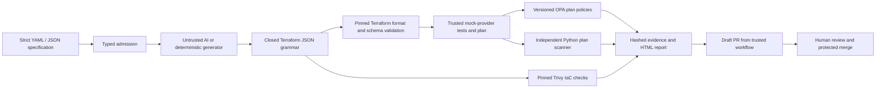

# AI-Validated IaC Pipeline

**Infrastructure requests become reviewable Terraform through a generator that has no security authority.** TypeScript validates a strict YAML or JSON specification, bounds the optional AI response, admits only an approved Terraform grammar, and runs independent Terraform, OPA and security scanner gates. A failed or unavailable gate blocks the candidate.

This project owns specification-driven generation and independent AI-output validation. It does not inventory deployed cloud estates or replace a cloud posture management system.

Published repository: [jayekwere/ai-validated-iac-pipeline](https://github.com/jayekwere/ai-validated-iac-pipeline). Baseline hosted verification passed. See [hosted evidence and approval status](docs/hosted-publication.md).

## Run the complete local demonstration

Requires Node 22.18+ (CI uses 24.13.0), Python 3.12+, macOS arm64 or Linux amd64, approximately 3 GB of free disk space, and public internet access for initial dependency/tool installation. Verification uses only pinned local tools and the provider mirror after bootstrap. Repository vulnerability scanning separately downloads public advisory data. No AI key, AWS credentials, paid account, or cloud account is needed.

```sh
npm ci --ignore-scripts
npm run bootstrap
npm run verify
node --experimental-strip-types scripts/adversarial.ts
node --experimental-strip-types scripts/build_index.ts
python3 scripts/check_workflows.py
python3 scripts/scan_repository.py
```

Open [the storage verification report](evidence/storage/report.html), [the platform report](evidence/platform/report.html), and [the adversarial report](evidence/adversarial/report.html). Each verification report is self-contained HTML with no JavaScript or external assets. Machine-readable plans, exact scanner decisions, tool logs, source hashes and audit records sit beside it. The CLI exits nonzero if a gate fails. The final verdict means **eligible for human review**, never permission to deploy.

```sh
node --experimental-strip-types src/cli.ts verify examples/storage.yaml evidence/my-request
```

## Architecture and trust boundaries



The verifier accepts a Terraform **JSON configuration**, the native `.tf.json` representation, not arbitrary HCL or a bundle of generated files. Generated output must exactly match the approved expansion of the request. Object key order may differ. Providers, resource classes, expressions, IAM grants, encryption, network topology and file paths cannot be extended by the generator. Modules are deliberately forbidden. Extending the vocabulary requires a reviewed compiler and policy change. This constrained design intentionally limits AI creativity to prevent unreviewed infrastructure capabilities.

The optional AI receives the approved template as context and returns a bounded JSON candidate. It cannot call tools, change a gate, add a workflow, or grant approval. The sample generator produces the same shape without AI and is always labeled **deterministic non-AI**. Both enter the same verification function.

Trusted test files and the provider lock are copied from the verifier, not accepted from generated output. Tool artifacts, extracted executables, the provider archive and Terraform mirror configuration are hash-verified before evaluation. Trusted source hashes are compared before and after evaluation. Commands use fixed executable paths and argument arrays, a reduced environment, timeouts and output limits. Generated commands are never executed. OPA runs local policies; Trivy uses the checks embedded in its pinned binary. The scanner's HCL view is rendered by trusted code from already-admitted Terraform JSON because scanner adapters can interpret nested JSON blocks differently.

## AWS examples

| Example | Approved configuration |
| --- | --- |
| Storage | Private bucket, public access blocks, customer managed KMS encryption, versioning, TLS-only policy, access logging |
| Compute | Private EC2 instance, encrypted root disk, IMDSv2, detailed monitoring, no public IP |
| IAM | EC2 trust policy and `s3:GetObject` scoped to one bucket prefix |
| Networking | Private app/data subnets across two zones, separate route tables, no Internet route, VPC flow logs, empty default security group |
| Load balancer | Internal ALB, HTTPS 443, TLS 1.2/1.3 policy, fixed response, deletion protection and access logs |
| Audit | Multi-region CloudTrail with validation and KMS, retained encrypted CloudWatch log group |
| Platform | All examples composed into one request |

The shared service log sink uses SSE-S3, as required by [ALB access logging](https://docs.aws.amazon.com/elasticloadbalancing/latest/application/enable-access-logging.html) and [S3 server access logging](https://docs.aws.amazon.com/AmazonS3/latest/userguide/UsingKMSEncryption.html). The exact exception to the scanner CMK recommendation is versioned in `policy/scanner-exceptions.json`; plaintext storage is never allowed. Low and medium scanner findings are disclosed in full; high and critical findings block unless an exact, reviewed resource exception applies. Log sinks are not recursively access-logged.

## What is actually verified

| Evidence | Meaning |
| --- | --- |
| TypeScript tests | Admission, output constraints, report escaping, API boundary and PR behavior |
| Python tests | Independent plan semantics, insecure and malformed cases |
| Terraform validate | Actual AWS provider schema checks, with the pinned real provider binary |
| Terraform test | Supported mock provider, `command = plan`, trusted assertions |
| Plan JSON | Terraform's real `test_plan` event, including all requested resources; computed values remain unknown where appropriate |
| OPA and Python decisions | Independent semantic checks of the structured mock plan |
| Trivy | Separate IaC checks on the trusted rendering, plus repository secret/dependency scanning |
| AI API contract tests | Simulated HTTP transport, including rejection/error cases; no paid API call is claimed |
| GitHub integration tests | Simulated GitHub API calls; no hosted CI result is claimed before publication |

Mock plans do not establish deployability, IAM authorization in an account, regional AMI availability, certificate ownership, service quota availability or actual log delivery. AMI, certificate and account identifiers are illustrative. There is no live provider/cloud verification. Azure and GCP are intentionally unsupported. No Terraform apply operation exists in the application or its workflows.

## Adversarial evidence

The executable adversarial suite feeds malicious candidates through the actual verifier and records the rejecting gate. It covers public storage, unrestricted administrative ingress, wildcard IAM grants, absent encryption, an unapproved module, an external command, policy modification, workflow injection and malformed Terraform. Missing and tampered scanners fail tool integrity before evaluation. Independent OPA and Python checks also reject mutations of an actual Terraform plan. A sentinel confirms that the injected external command did not execute.

Read the generated evidence for precise results; ordinary unit tests are not substitutes for those demonstrations. Unknown or missing decisions, unavailable executables, command timeouts, truncated responses and scanner errors deny approval.

## Optional real AI generation

The integration uses the [OpenAI Responses API](https://developers.openai.com/api/docs/guides/structured-outputs?api-mode=responses), a fixed HTTPS endpoint, JSON output mode, a 45 second deadline, one request without retries, a 12,000 token output ceiling and a 256 KiB response cap. Redirects are rejected; API response bodies are excluded from error messages. Credentials are never sent to Terraform or scanners. `OPENAI_MODEL` defaults to `gpt-4.1-mini` and may select another supported `gpt-` model. Availability is account-dependent.

```sh
# This flag explicitly authorizes a paid API call. Do not put keys in files.
export OPENAI_API_KEY='...'
node --experimental-strip-types src/cli.ts generate-ai examples/storage.json --authorize-paid-api
```

The generated candidate still must pass the same strict grammar and all verification gates. No real paid AI call was made during development. Contract tests use a clearly identified mock HTTP transport.

## GitHub Actions and review

Four workflows provide specification admission, complete unprivileged PR CI, and manually dispatched trusted generation. The generation workflow runs only on `main`. Its secret-bearing generation job writes three data files and executes no generated code. A separate secret-free job verifies the candidate. A protected publication job receives only the needed repository and PR write permissions and opens a **draft** PR containing fixed paths under `generated/`. It does not merge.

All Actions are pinned to immutable commits. Checkout does not persist credentials. Shell commands do not interpolate event data; controlled inputs pass through environment variables and strict validation. Untrusted PR tests have read-only permissions and no repository secrets. A separate trusted-base workflow verifies generated data without executing candidate code.

The active main ruleset has no bypass actors, pins required status checks to GitHub Actions, and requires a successful protected `maintainer-approval` deployment before merge. The runtime boundary check reads effective active rules using metadata read access. Mark generated draft PRs ready for review to start required validation, since GITHUB_TOKEN-created events do not themselves trigger Actions.

The solo maintainer approves manually through `maintainer-approval`, `ai-generation` and `pr-publication`. These environments require `jayekwere`, allow the maintainer to approve their own runs, and disable administrator bypass. Native PR approving-review count is zero; the required approval deployment replaces the impossible self-review while preserving every security check. The boundary checker fails closed if any required gate is absent. See [the solo-maintainer flow](docs/solo-maintainer.md) and [publication setup](docs/publication.md).

## Evidence and reproducibility

The report includes SHA-256 hashes of the normalized specification and Terraform plus every trusted source file, policy, tool lock and dependency lock. Hash equality is tested independently of object key order. Tool installation uses verified release archives, the AWS provider lock includes both supported platform hashes, and provider installation has no direct network fallback. Plan timestamps and tool logs vary between runs; the specification and generated source hashes remain reproducible. Audit JSONL is a sequence of decisions with specification hashes, not a tamper-proof external audit service.

See [SECURITY.md](SECURITY.md) for the threat boundary and [docs/verification.md](docs/verification.md) for the local acceptance procedure. This repository contains no deployment authority.

---

**AI assistance:** AI tools helped with code or documentation.
